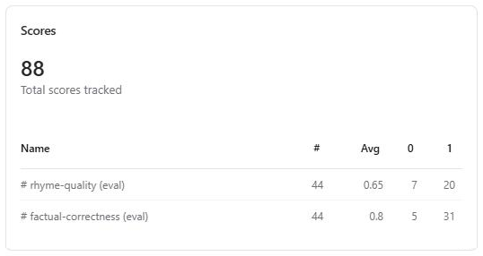
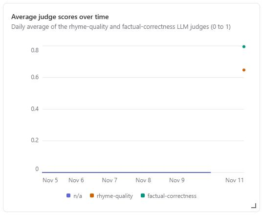
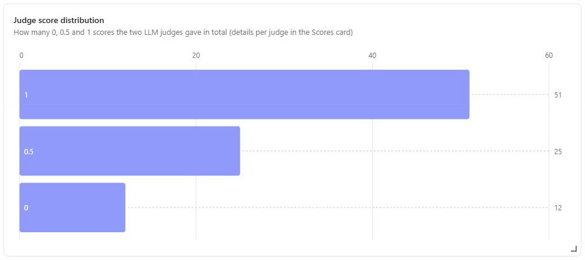
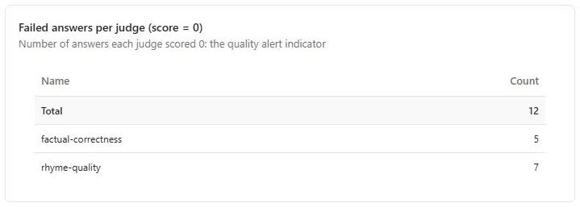
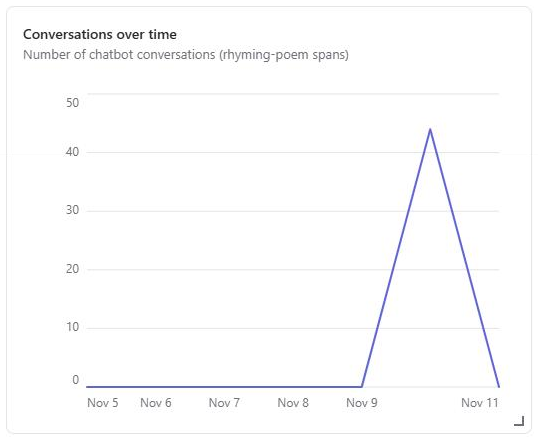
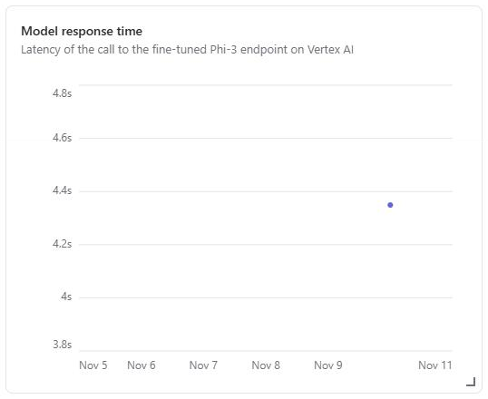
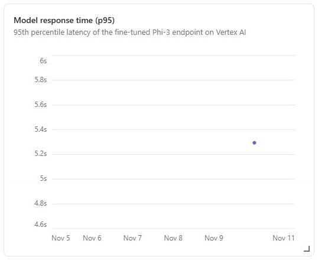
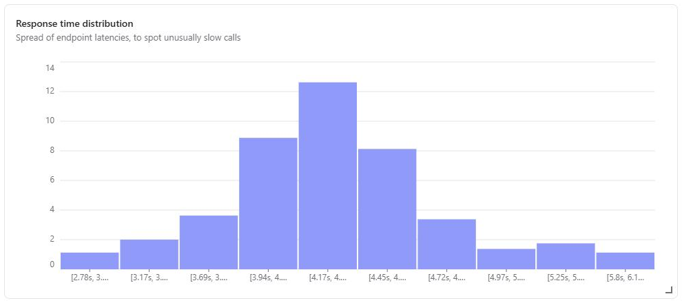
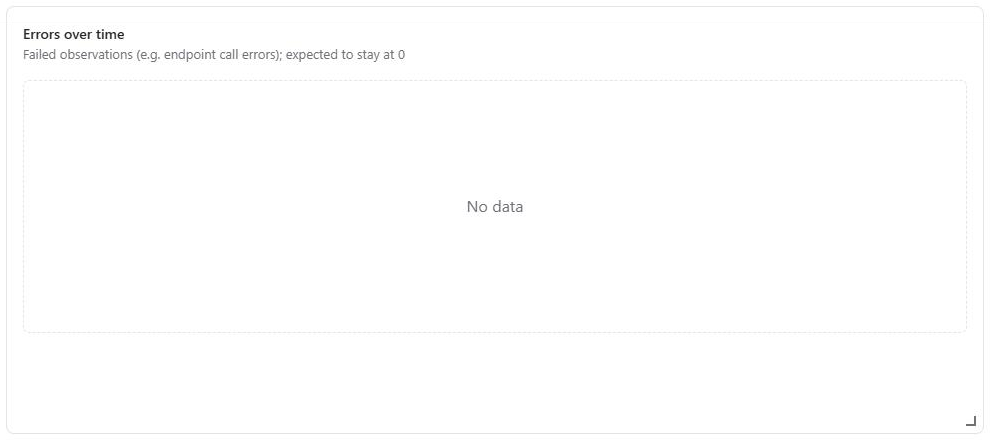
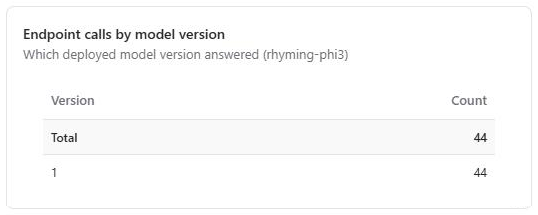

# Agentic Workflows

Team repository for the **Agentic Workflows / LLMOps** course (Albert School, MSc2).

Fine-tuning Phi-3-mini (LoRA) on Vertex AI Pipelines to answer questions with a 4-line AABB rhyming poem. The pipeline was first built on the course's Yoda example, then reused on our own dataset (`rhyming_qa_700.csv`).


## Prerequisites

- [Git](https://github.com/git-guides/install-git)
- [Docker](https://docs.docker.com/desktop/)
- [uv](https://docs.astral.sh/uv/getting-started/installation/)
- [Google Cloud CLI](https://cloud.google.com/sdk/docs/install)

## Installation

```
git clone https://github.com/Andrianrjs/Agentic-workflows.git
cd Agentic-workflows
uv sync
```

`uv sync` creates the `.venv` folder (Python 3.11) with the project dependencies.

Then configure your IDE to use `.venv/bin/python` (`which python` should point to it).

## GCP setup

```
gcloud auth login
gcloud config set project <PROJECT_ID>
gcloud auth application-default login
```

```
cp .env.example .env
```

| Variable | Description |
| --- | --- |
| `GCP_PROJECT_ID` | agentics-workflows-510809 |
| `GCP_REGION` | GCP region (`europe-west2`) |
| `GCP_BUCKET_NAME` | GCS bucket (`clem-andrian-llmops`) |
| `GCP_PROJECT_NUMBER` | Project number (`123905721265`) |
| `GCP_ENDPOINT_ID` | ID of the deployed endpoint (changes at each deployment) |


The `.env` file is ignored by git: never commit it.

## Check the setup

```
uv run python scripts/validate_gcp_setup.py
```

The script initializes Vertex AI and lists the contents of the GCS bucket.

## Run the pipeline

Test the data transformation component locally:

```
uv run python scripts/test_component_locally.py
```

Compile and submit the pipeline to Vertex AI:

```
uv run python scripts/pipeline_runner.py
```

## Structure

```
├── src/agentic_workflows/
│   ├── constants.py              # Settings loaded from .env
│   ├── handler.py                # Custom EndpointHandler for Vertex AI serving
│   ├── app/main.py               # Chainlit chat app
│   ├── pipeline_components/      # Pipeline steps (KFP components)
│   └── pipelines/                # Pipeline definitions
├── scripts/
│   ├── validate_gcp_setup.py     # GCP connection test
│   ├── test_component_locally.py # Run a component locally
│   ├── pipeline_runner.py        # Compile and submit to Vertex AI
│   └── register_model_with_custom_handler.py  # Upload handler + register model
├── docs/langfuse/                # Langfuse dashboard screenshots (session 5)
├── sample_request.json           # Example prediction request
├── session*_practice.md          # Practice instructions
├── pyproject.toml / uv.lock      # Dependencies
└── .env.example                  # Environment variables template


```


## Results

| Run | Data | Epochs | train_loss | eval_loss | ROUGE-L | BLEU | Exact match | Rhyme score |
|---|---|---|---|---|---|---|---|---|
| 2026-11-05 18:02 | Yoda (course example) | 10 | 0.90 | 2.90 | 0.82 | 0.67 | 0.22 | — |
| 2026-11-08 19:15 | Rhyming Q&A, 700 pairs | 5 | 0.79 | 1.32 | 0.31 | 0.11 | 0.00 | 0.62 |

- **Yoda run:** clear overfitting (eval_loss went back up after epoch ~3, see TensorBoard). Fixed by keeping the best checkpoint (`load_best_model_at_end`) and reducing to 5 epochs.
- **Rhyming run:** the rhyme score went from 0.25 (Colab test, 100 pairs) to 0.62 with 700 pairs, so more data clearly helped.
- ROUGE/BLEU/exact match are low on purpose: the model writes its own poem instead of copying the reference, so word overlap is not a good measure for this task.
- Factual correctness is not measured by the pipeline: it is measured on live conversations with an LLM judge in session 5 (average 0.80, see [Monitoring with Langfuse](#monitoring-with-langfuse)).

### Sample outputs (rhyming run, 2026-11-08)

Three poems from the test set, read by hand to check rhymes and facts.

**"What did Abraham Lincoln do?"** · rhyme 1.0 · ROUGE-L 0.64

> Abraham Lincoln was the sixteenth president of the United States,
> Who led the country through the Civil War's fates;
> He freed the slaves with the Emancipation Proclamation's might,
> And gave the Gettysburg Address in a short, powerful flight.

Facts are correct. Some words are only there to rhyme ("the Civil War's fates").

**"Is Bitcoin real money?"** · rhyme 0.5 · ROUGE-L 0.25

> Bitcoin is a digital currency without a bank,
> People can send it without a paper or a rank;
> It is not controlled by any government's hand,
> But its value can change, as the market demands.

Facts are correct, but line 2 is filler and the poem doesn't clearly answer the question. "hand / demands" rhymes to the ear but scores 0 because of the final "s": the rhyme score is strict.

**"Why do museums exist?"** · rhyme 1.0 · ROUGE-L 0.22

> Museums collect and display objects of art and history,
> From ancient statues to paintings of great mystery;
> They help us learn about people and places far away,
> And protect them so future generations can see them one day.

The best of the three: correct rhymes, and it actually answers "why". Yet it has the lowest ROUGE-L, which shows that word overlap with the reference is not a good measure of quality here.

**Takeaways:** all three are factually correct; the main weakness is filler words chosen for the rhyme; the rhyme score slightly underestimates the model.

## Deployment

The model from run `rhyming-model-training-pipeline-20261108191541` is registered in Vertex AI Model Registry as `rhyming-phi3` (v1), with a custom `handler.py` for the Hugging Face inference container.

Register a model (uploads `handler.py` next to the artifacts, then registers it):

```
uv run python scripts/register_model_with_custom_handler.py \
  --model-uri gs://<bucket>/pipeline_root/.../fine-tuning-component_.../model \
  --model-name rhyming-phi3
```

Deploy it from the console: Model registry → `rhyming-phi3` → Deploy to endpoint (n1-standard-8, 1 × T4, min/max 1 node). **Delete the endpoint after use.**

Test it:

```
gcloud ai endpoints predict <ENDPOINT_ID> \
  --project=agentics-workflows-510809 \
  --region=europe-west2 \
  --json-request=sample_request.json
```

Test on 2026-11-09 ("Why is the sky blue?"):

> Sunlight is made of all colors to see,
> But the air scatters the short waves, so free;
> Blue light is scattered more than the rest,
> So the sky looks blue, as it is best.

## Chat app

Requires a deployed endpoint and `GCP_ENDPOINT_ID` set in `.env` (the ID changes at each deployment).

```
uv run chainlit run src/agentic_workflows/app/main.py -w
```

Then open http://localhost:8000.


## Monitoring with Langfuse

Session 5: every conversation of the Chainlit app is traced in a self-hosted [Langfuse](https://langfuse.com), scored by two LLM-as-a-judge evaluators, and summarised in a monitoring dashboard.

### Run Langfuse locally

Langfuse runs with Docker Compose, outside this repository:

```
git clone https://github.com/langfuse/langfuse.git
cd langfuse
docker compose up -d
```

Open http://localhost:3000, create an organization and a project, then create an API key in the project settings and add it to `.env` (see `.env.example`):

```
LANGFUSE_SECRET_KEY=sk-lf-...
LANGFUSE_PUBLIC_KEY=pk-lf-...
LANGFUSE_BASE_URL=http://localhost:3000
```

Then start the chat app as described in [Chat app](#chat-app): each message appears in the **Tracing** tab.

### What is logged

`src/agentic_workflows/app/main.py` creates one trace per user message:

| Observation | Type | Input | Output | Other data |
|---|---|---|---|---|
| `rhyming-poem` | span (`@observe`) | the user's question | the poem shown in the chat | |
| `vertex-endpoint-call` | generation, nested in the span | the request sent to the endpoint (Phi-3 chat template + generation parameters) | the raw Vertex AI response | model name and version (`modelDisplayName`, `modelVersionId`), endpoint ID, generation parameters, latency |

The `chainlit` and `fastapi` instrumentation scopes are blocked (`blocked_instrumentation_scopes`), so the technical spans of the web server (`GET /user`, `fastapi.endpoint`...) are not sent to Langfuse.

### LLM-as-a-judge evaluators

Both judges run on Gemini (`gemini-3.5-flash-lite`, Google AI Studio free tier), on every observation named `rhyming-poem` (100% sampling), and return a score between 0 and 1 with a short explanation. Their prompts use few-shot examples and the `{{input}}` / `{{output}}` variables.

| Evaluator | What it checks | 1 | 0.5 | 0 |
|---|---|---|---|---|
| `rhyme-quality` | the form: an English quatrain with an AABB rhyme scheme | 4 lines, both pairs rhyme | one pair rhymes, or wrong number of lines | not a poem, or no rhyme |
| `factual-correctness` | the facts stated in the poem, ignoring the form | correct and answers the question | partly correct or does not really answer | false or invented fact |

### Results (44 test conversations, 2026-11-10)

The endpoint was deployed for about one hour and 44 varied questions were asked in Chainlit (factual questions, false-premise questions, a question in French, a greeting, a request for a haiku...).

| Metric | Value |
|---|---|
| Conversations | 44 |
| `rhyme-quality` | average **0.65** (20 scores at 1, 17 at 0.5, 7 at 0) |
| `factual-correctness` | average **0.80** (31 scores at 1, 8 at 0.5, 5 at 0) |
| Endpoint latency | average 4.35 s, p95 5.3 s (n1-standard-8 + 1 × T4) |
| Errors | 0 |

- The LLM judge (0.65) and the pipeline's dictionary-based rhyme score on the test set (0.62) agree: the model rhymes correctly about two times out of three.
- The model is mostly factually right (0.80), but it tends to follow the premise of the question instead of correcting it.
- The conversations are dated 2026-11-10 and the scores 2026-11-11: the judges were run on the existing traces afterwards (see problems below). With the current setup, new conversations are scored about a minute after they arrive.

### Examples

| Question | Answer (excerpt) | Rhyme | Facts | Judge's explanation (excerpt) |
|---|---|---|---|---|
| What is machine learning, in simple terms? | *Machine learning is a way for computers to learn, / From data and examples, without being stern; ...* | 1 | 1 | Both pairs rhyme (learn/stern, own/known); correct simple definition. |
| Why is the Great Wall of China visible from space? | *... It stretches for thousands of kilometers in length, / And can be seen from space, though it is not strong.* | 0.5 | **0** | "The answer claims that the Great Wall of China can be seen from space, which is a common myth." |
| Why did Einstein win the Nobel Prize for his theory of relativity? | *Albert Einstein developed the theory of relativity, / Which changed how we understand space and time's reality; ...* | 1 | **0** | Einstein did not win the Nobel Prize for relativity (it was for the photoelectric effect). |
| What is the capital of Australia, Sydney? | *Sydney is Australia's largest city, by the sea, / With the Opera House and Harbour Bridge to see; ...* | 1 | 0.5 | Correct facts about Sydney, but the false premise (the capital is Canberra) is not corrected. |
| Can you write me a haiku about the sea? | *The sea is deep and wide, / With waves that crash and tides that ride; / It holds secrets in its blue.* | 0.5 | 0.5 | Only three lines instead of a quatrain, and not a real haiku either. |
| Hello! | *A greeting is a friendly word or phrase, / Like hello or hi, to make someone's day; ...* | **0** | 1 | "phrase/day and meet/be do not form an AABB rhyme scheme". The model explains what a greeting is instead of greeting back. |

### Dashboard

The **Rhyming poems monitoring** dashboard (period: past 7 days) follows the course's metric families: model quality (LLM judges) and operational metrics (volume, latency, errors, model version).

| | |
|---|---|
|  |  |
|  |  |
|  |  |
|  |  |
|  |  |

With a single test session, the time series only have one point; in production they would show a drop in quality or a rise in latency immediately.

### Problems encountered and changes made

| Problem | Cause | Change |
|---|---|---|
| Langfuse filled with `GET /user`, `fastapi.endpoint`... traces, and the judges scored them | FastAPI (0.162) now emits its own OpenTelemetry spans under the `fastapi` scope; blocking `chainlit` was not enough | Added `"fastapi"` to `blocked_instrumentation_scopes` |
| The judges never scored the conversations | The default rule filter `isRootObservation = true` excluded them: `rhyming-poem` is nested under a web-server span | Rule filter changed to `name = rhyming-poem` |
| Most judge calls failed (evaluator status FAILING) | Gemini free tier: 15 requests per minute, and 88 requests were sent at once | Existing traces re-scored in batches of 10 conversations, one judge at a time; live traffic stays far below the limit |
| `gemini-2.5-flash` rejected when creating the LLM connection | Model no longer available to new users | Switched to `gemini-3.5-flash-lite` |
| Chainlit could not get a Google access token on Windows | `subprocess` cannot find `gcloud.cmd` by name | `shutil.which("gcloud")` in `get_access_token` |
| Bar charts were misleading (axes starting at 5, 10 or 38) | Automatic y-axis scaling in Langfuse | Pivot tables and a horizontal bar chart starting at 0 |

### Limitations

- The judges are LLMs too: their scores are useful to spot big problems and regressions, but a sample should still be checked by hand (course, session 5). For example, on "Who is Andrian?" the model describes the name rather than the person, and the judge accepts it.
- No user feedback is collected (no thumbs up/down in Chainlit), so the course's third metric family (user satisfaction) is not covered.
- Token usage and cost are not logged, because the custom `handler.py` does not return token counts.

## Model Registry

| Model | Version | Resource name | Trained by run |
|---|---|---|---|
| rhyming-phi3 | 1 | `projects/123905721265/locations/europe-west2/models/2406050299945943040` | rhyming-model-training-pipeline-20261108191541 |

